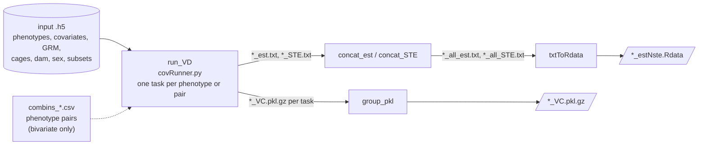
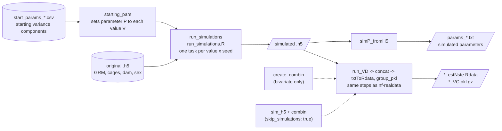

# CoreQuantGen

Code and Nextflow pipelines for quantitative genetic analysis of social individuals (e.g. laboratory rodents sharing a cage),
estimating Direct and Indirect Genetic Effects.

## In brief
An individual's phenotype (a measurable trait, e.g. body weight or the abundance of a gut bacterium)
can be influenced by its own genes, the genes of interacting social partner(s) and other environmental effects. We call

- **DGE, direct genetic effects:** the effects of an individual's own genotype on its own phenotype.
- **IGE, indirect genetic effects:** the effects of the social partners' (cage mates') genotypes on the phenotype of another individual.
- **DEE, direct environmental effects**, i.e. noise (always present), 
- **IEE, indirect environmental effects** non-genetic component of effects from social partner (always present when model IGE), 
- **cageEffect, cage effects** (environment shared by animals in the same cage, e.g. light or noise depending on the cage's position in the animal house) and 
- **maternalEffect, maternal effects** (effects of the mother's genotype or environment on the offspring's phenotype).

## What can you do

**Variance Decomposition (VD):** estimating how much of the variation in a trait is explained by each of the variance components above. It can be run in three mode:

| Mode | Input | Purpose |
|---|---|---|
| univariate (`uni`) | one phenotype at a time | estimate how much a phenotype is affected by IGE |
| bivariate (`bi`) | a pair of phenotypes | estimate the correlation between IGE and DGE, to identify proxy phenotypes that mediate IGE |
| sex-variate (`sex`) | one phenotype split into females and males | estimate the correlation between female and male IGE, to identify phenotypes for the mechanism mediating IGE is different in females and males |

**Genome Wida Association Study (GWAS)**: to identify genetic variants that are statistically associated with complex trait of the own individual (dge-GWAS) or with the trait of the cage mate and could possibly point to genes involved in the mediation of IGE (ige-GWAS). It runs in univariate mode only.

## Repo map


| Folder | What it does | Status |
|---|---|---|
| [`nf-realdata/`](nf-realdata) | Nextflow pipeline: runs variance decomposition on real phenotypes stored in an `.h5` file | finished |
| [`nf-simulations/`](nf-simulations) | Nextflow pipeline: simulates phenotypes with user-defined variance components, then runs VD on them | finished |
| [`nf-genotype-prep/`](nf-genotype-prep) | Nextflow pipeline: prepares genotypes for GWAS (VCF filtering, PLINK conversion, pruning, GRM and LOCO GRMs) | under development |
| [`nf-gwas/`](nf-gwas) | Nextflow pipeline: GWAS with leave-one-chromosome-out (LOCO) null covariances | under development |
| [`code/`](code) | analysis scripts, most of them called by the pipelines: VD and GWAS mapping, input preparation, output parsing; see [its README](code/README.md) | |
| [`containers/`](containers) | Dockerfiles for the two images built for this repo | |

**NB: Scripts in `bin/` are symlinks.** Each pipeline's `bin/` folder links to scripts in `code/`
(e.g. `nf-realdata/bin/covRunner.py -> ../../code/VD/covRunner.py`), because the same scripts are shared
by several pipelines. Nextflow adds `bin/` to the `PATH` of each task, so the container images contain the
software dependencies but not the analysis scripts. Clone the whole repo, not a single pipeline folder.

## Quick start

<!-- TODO: verify — commands below are taken from the submit scripts in the repo and have not been confirmed yet -->

**Requirements**

- Nextflow 25.04.6.
- Singularity/Apptainer or Docker.
- An input `.h5` file, structured as described in [`code/VD/README.md`](code/VD/README.md#how-to-write-the-h5-input). 
<!-- TODO: verify — add example dataset in the repo -->

**Profiles** (combine one container engine with one infrastructure):

| Profile | Sets |
|---|---|
| `singularity` | Singularity, image cache in `$HOME/singularity/containers` |
| `docker` | Docker |
| `crg` | SLURM at the CRG cluster (queue and QOS) |
| `local` | local executor, resources capped at 16 GB / 4 CPUs / 24 h |

**nf-realdata**

<!-- TODO: verify - if works with your small .h5-->
```bash
cd nf-realdata
nextflow run main.nf -profile singularity,crg -params-file <params.yaml> -resume
```
<!-- TODO: verify - add the template params file-->
Template: ...



Outputs: in `<outdir>/VD/<vdMODEL>variate/<PHENOV>/<GRMV>_<SUBSET>_<EFFECTS>/`:
- per-task estimates (`*_est.txt`) and standard errors (`*_STE.txt`)
- concatenated results (`all_est.txt`, `all_STE.txt`),
- `.Rdata` file with estimates and standard errors together (`estNste.Rdata`),
- pickled VD objects grouped in `VC.pkl.gz`. <br/>

Nextflow timeline and report go to `<outdir>/pipeline_info/`.

**nf-simulations**

<!-- TODO: verify - test on small .h5 -->
```bash
cd nf-simulations
nextflow run main.nf -profile singularity,crg -params-file <params.yaml> -resume
```

Templates: [`params/params.simDFT.yaml`](nf-simulations/params/params.simDFT.yaml) (params file, with comments) and
[`input/vc/start_params_setDFT.csv`](nf-simulations/input/vc/start_params_setDFT.csv) (starting variance components). <br/>
The pipeline simulates phenotypes from the GRM, cages and (optionally) dams of an existing `.h5`, then runs the same VD steps as `nf-realdata`.
With `skip_simulations: true` it runs VD only, on an already simulated `.h5`.



Outputs: 
- simulations in `<output_folder>/mockphenos/cage_<NCAGES>/set<SIT>/<P>/<value>/<seed>/`,
- VD results in `<output_folder>/VD/cage_<NCAGES>/set<SIT>/<P>/<value>/<seed>/<vdMODEL>variate/<PHENOV>/`.

Nextflow timeline and report go to `<outdir>/pipeline_info/`.


**At CRG**, `nf-realdata/submit_DFT.sh` and `nf-simulations/submit_simPOP_DFT.sh` wrap the commands above for SLURM;
edit the lines marked `EDIT HERE` before running them with `sbatch`.

## Authors and contributions

- **Hélène Tonnelé** developed the analysis and the four Nextflow pipelines, extended the VD wrappers
  (`covRunner.py`, `dirIndirVD.py`) with the options and the bivariate additions, and wrote `partcorrCov.py` with Francesco Paolo Casale.
- **Amelie Baud** created the repository, the original univariate DGE/IGE code and the VD wrappers,
  and wrote the bivariate covariance classes with Francesco Paolo Casale.
- **Francesco Paolo Casale** wrote or co-wrote several of the covariance classes in `code/VD/classes/`.

`code/VD/` extends the open-source limix libraries (limix-core, limix-lmm), which are installed as dependencies and not copied into the repo.

## Status and limitations

- The pipelines follow some nf-core conventions (one module per folder, labels for resources, separate profiles for container engine and infrastructure)
  but were not built from the nf-core template and are not linted (no nf-test, no test profile, parameters are not validated)
- The R packages in `containers/r-simulations/Dockerfile` are not version-pinned, so a rebuild may install newer versions than the published `tonnelene/r-simulations:1.0` image.

## Citation

This code was used to publish results in: 
- Baud, A., Casale, F.P., Barkley-Levenson, A.M. et al. Dissecting indirect genetic effects from peers in laboratory mice.
  *Genome Biol* 22, 216 (2021). https://doi.org/10.1186/s13059-021-02415-x
- Tonnelé, H., Chen, D., Morillo, F. et al. Genetic architecture and mechanisms of host-microbiome interactions from a multi-cohort analysis of outbred laboratory rats.
  *Nat Commun* 16, 10126 (2025). https://doi.org/10.1038/s41467-025-66105-z <br/>
  Scripts for analyses and figures are in [Baud-lab/P50](https://github.com/Baud-lab/P50/tree/Master/16S)
- Preprint: Tonnelé, H., Casale, F.P., Baud, A., Phenome-wide genetic framework to identify mechanisms of social effects, *bioRxiv* 2026.03.10.710784, https://doi.org/10.64898/2026.03.10.710784. <br/> Scripts for analyses and figures are in [Baud-lab/CFW_HS_mice](https://github.com/Baud-lab/CFW_HS_mice/tree/Master/bivIGE_paper).

If you use this code please cite: 
- Baud, A., Casale, F.P., Barkley-Levenson, A.M. et al. Dissecting indirect genetic effects from peers in laboratory mice.
  *Genome Biol* 22, 216 (2021). https://doi.org/10.1186/s13059-021-02415-x
- Tonnelé, H., Casale, F.P., Baud, A., Phenome-wide genetic framework to identify mechanisms of social effects, *bioRxiv* 2026.03.10.710784, https://doi.org/10.64898/2026.03.10.710784

Software citation: [`CITATION.cff`](CITATION.cff) (Zenodo DOI [10.5281/zenodo.4965824](https://doi.org/10.5281/zenodo.4965824)).


## License

Apache License 2.0, see [`LICENSE`](LICENSE).
