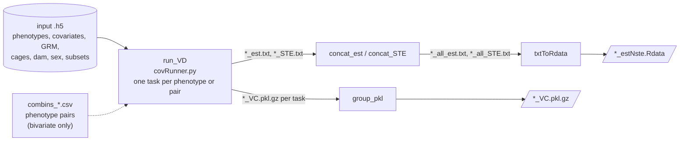

# nf-realdata

Nextflow pipeline that runs variance decomposition (VD) on real phenotypes stored in an `.h5` file,
in univariate, bivariate or sex-variate mode (see the [main README](../README.md#what-can-you-do)).



## Inputs

- **`.h5` file** with phenotypes, cages and GRM (required), and covariates, dam, sex and subsets (optional),
  structured as described in [`code/VD/README.md`](../code/VD/README.md#how-to-write-the-h5-input).
- **Params file**: copy the template [`params/params.DFT.yaml`](params/params.DFT.yaml) and fill it in.
  The subgroup names (`PHENOV`, `CAGEV`, `GRMV`, ...) must match the ones in the `.h5`.
- **Bivariate only**: a `combins_<name>.csv` file in `combinDir`, with one pair of phenotypes per line
  (column numbers or phenotype IDs), e.g. [`input/dataset/combins_5phenos.csv`](input/dataset/combins_5phenos.csv).

## Run

Run from this folder (`nf-realdata/`); the repo must be cloned whole, because `bin/` links to scripts in `../code/`.

**Test** on the small dataset in [`../data/test.h5`](../data) (200 individuals, 5 phenotypes):

```bash
nextflow run main.nf -profile test,docker,local
```

Add `--vdMODEL bi` to test the bivariate model. Results go to `./test_output/`.

**On your data**, with a params file:

```bash
nextflow run main.nf -profile docker,local -params-file params/params.<POP>_<model>.yaml -resume
```

Choose one container engine (`singularity` or `docker`) and one infrastructure (`crg` or `local`);
see the profiles in the [main README](../README.md#quick-start).

**At CRG, as a SLURM job**: [`submit_DFT.sh`](submit_DFT.sh) runs the command above as a job, so that Nextflow
keeps running after you log out and submits each task to SLURM.

1. Copy it (e.g. to `submit_<POP>.sh`) and edit the lines marked `EDIT HERE`:
   the job name, the paths for the SLURM `.out`/`.err` logs, the output folder, the params file (`PARFILE`) and the work directory (`-w`).
2. Submit it from this folder:

   ```bash
   sbatch submit_<POP>.sh
   ```

The Nextflow log is written to `./log/`, the execution trace is moved to `./trace/` at the end. <br/>
If need to stop, use `scancel`, the script forwards a cancel signal to Nextflow, so that the tasks it submitted are stopped too.

## Outputs

In `<outdir>/VD/<vdMODEL>variate/<PHENOV>/<GRMV>_<SUBSET>_<EFFECTS>/`:

- per-task estimates (`*_est.txt`) and standard errors (`*_STE.txt`), in one folder per trait; these are symlinks to the work directory
- concatenated results (`*_all_est.txt`, `*_all_STE.txt`)
- estimates and standard errors together in an `.Rdata` file (`*_estNste.Rdata`)
- pickled variance decomposition objects grouped in `*_VC.pkl.gz`, they contain covariance matrices that could be used as initialisation for testing correlation constrain

Nextflow timeline and report go to `<outdir>/pipeline_info/`.
