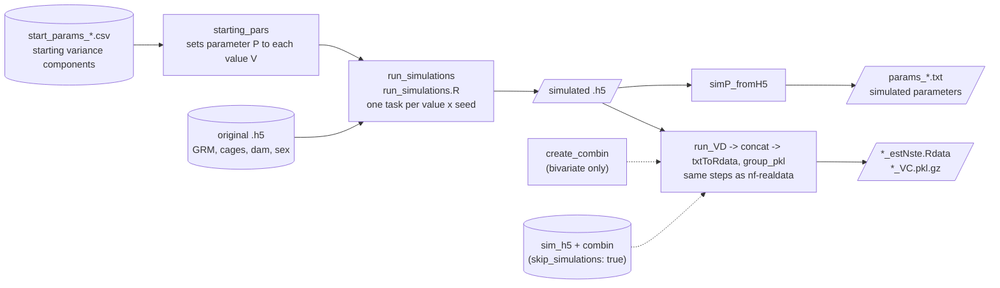

# nf-simulations

Nextflow pipeline that simulates phenotypes with user-defined variance components, using the GRM, cages and
(optionally) dams of an existing `.h5`, then runs the same variance decomposition (VD) steps as [`nf-realdata`](../nf-realdata).



## Inputs

- **Original `.h5` file** with GRM and cages (required), and dam and sex (optional),
  structured as described in [`code/VD/README.md`](../code/VD/README.md#how-to-write-the-h5-input).
  With `DAMV: "None"`, dams are simulated (individuals assigned at random to dams).
- **Starting variance components**: copy the template [`input/vc/start_params_setDFT.csv`](input/vc/start_params_setDFT.csv)
  and fill in one value per line (`param_name,value`; 0 for components you don't want to simulate).
- **Params file**: copy the template [`params/params.simDFT.yaml`](params/params.simDFT.yaml) and fill it in.
  `P` is the parameter set to each value in `V`; each value is simulated once per seed in `SEED`.
  `NCAGES` is the number of cages to keep; use the total number of cages to keep all of them.

## Run

Run from this folder (`nf-simulations/`); the repo must be cloned whole, because `bin/` links to scripts in `../code/`.

**Test** on the small dataset in [`../data/test.h5`](../data) (200 individuals, 49 cages; 10 univariate phenotypes simulated
with the starting values in [`input/vc/test_start_params.csv`](input/vc/test_start_params.csv)):

```bash
nextflow run main.nf -profile test,docker,local
```

Results go to `./test_output/`.

**On your data**, with a params file:

```bash
nextflow run main.nf -profile singularity,crg -params-file params/params.sim<POP>.set<NAME>.yaml -resume
```

Choose one container engine (`singularity` or `docker`) and one infrastructure (`crg` or `local`);
see the profiles in the [main README](../README.md#quick-start).
To run VD only on an already simulated `.h5`, set `skip_simulations: true`, `sim_h5` and `combin` in the params file.

**At CRG, as a SLURM job**: [`submit_simPOP_DFT.sh`](submit_simPOP_DFT.sh) runs the command above as a job, so that Nextflow
keeps running after you log out and submits each task to SLURM.

1. Copy it (e.g. to `submit_sim<POP>.sh`) and edit the lines marked `EDIT HERE`:
   the job name, the paths for the SLURM `.out`/`.err` logs, the output folder, the params file (`PARFILE`) and the work directory (`-w`).
2. Submit it from this folder:

   ```bash
   sbatch submit_sim<POP>.sh
   ```

The Nextflow log is written to `./log/`, the execution trace is moved to `./trace/` at the end. <br/>
If you need to stop, use `scancel`, the script forwards a cancel signal to Nextflow, so that the tasks it submitted are stopped too.

## Outputs

- Simulated `.h5` and simulated parameters (`params_*.txt`) in `<output_folder>/mockphenos/cage_<NCAGES>/set<SIT>/<P>/<value>/<seed>/`
- VD results in `<output_folder>/VD/cage_<NCAGES>/set<SIT>/<P>/<value>/<seed>/<vdMODEL>variate/<PHENOV>/`:
  concatenated estimates and standard errors (`*_all_est.txt`, `*_all_STE.txt`), both in an `.Rdata` file (`*_estNste.Rdata`),
  and pickled VD objects (`*_VC.pkl.gz`)

Nextflow timeline and report go to `<output_folder>/pipeline_info/`.
